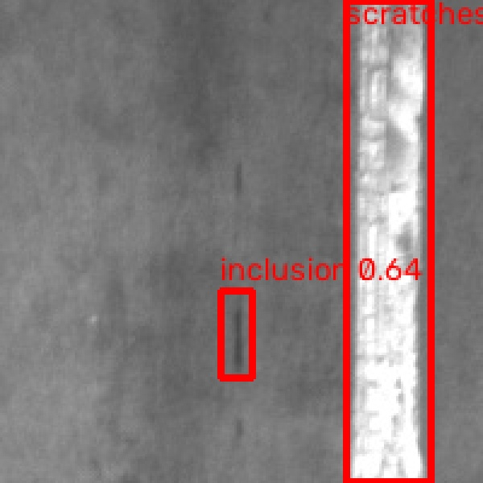
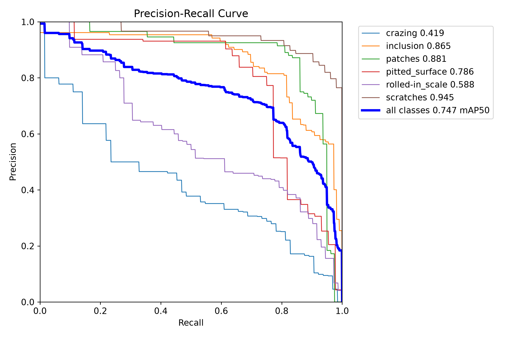
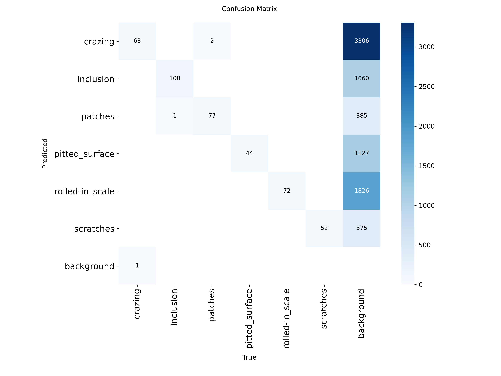
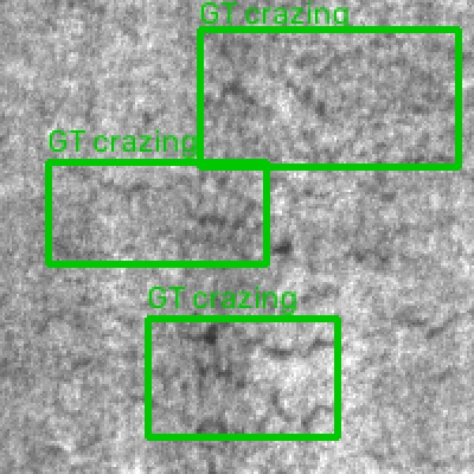
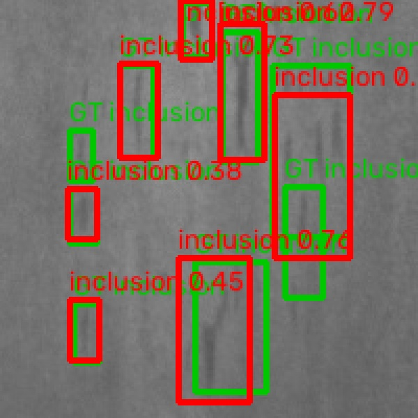
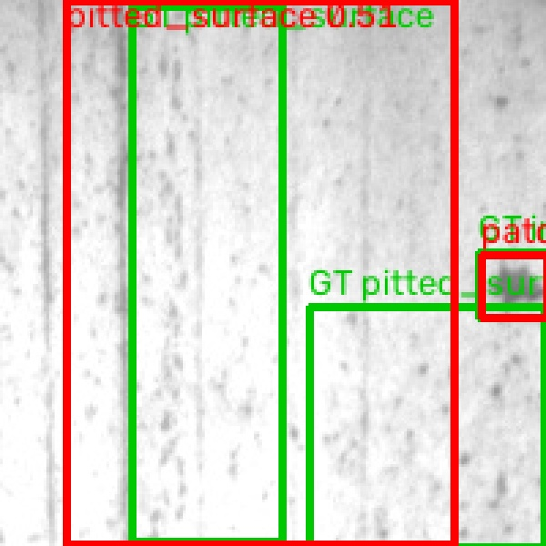

# 钢铁表面缺陷检测 · NEU-DET + YOLOv8n

工业质检 demo：热轧钢板表面 6 类缺陷的目标检测。上传一张钢板图，模型框出缺陷并给出类别与置信度。



*示例：scratches_138，2 处缺陷全部检出（scratches 0.89、inclusion 0.64）。*

## 1. 数据集

- **NEU-DET**（东北大学热轧钢板表面缺陷集，Song & Yan, *Applied Surface Science* 2013）
  来源：Hugging Face `KeenForgeAI/NEU-DET-corrected`（上游 NEU-DET，去掉 3 张重复图后 1,797 张）。
- 1,797 张灰度图，200×200，6 类各约 300 张：crazing（裂纹）、inclusion（夹杂）、
  patches（斑块）、pitted_surface（麻面）、rolled-in_scale（氧化皮）、scratches（划痕）。
- Pascal VOC XML 标注 → YOLO 格式（`scripts/prepare_data.py`）。
- 划分（数据集自带 ImageSets，8:1:1 分层）：train 1,437 / val 180 / test 180。

## 2. 指标（test 集，180 张，置信度阈值 0.25）

| 类别 | Precision | Recall | mAP50 | mAP50-95 |
| --- | --- | --- | --- | --- |
| crazing | 0.442 | 0.384 | 0.419 | 0.160 |
| inclusion | 0.638 | 0.862 | 0.865 | 0.466 |
| patches | 0.732 | 0.897 | 0.881 | 0.614 |
| pitted_surface | 0.803 | 0.743 | 0.786 | 0.546 |
| rolled-in_scale | 0.454 | 0.693 | 0.588 | 0.260 |
| scratches | 0.730 | 1.000 | 0.945 | 0.592 |
| **全部** | **0.633** | **0.763** | **0.748** | **0.440** |

验证集（val）最佳 mAP50 为 0.763（epoch 49）。训练：YOLOv8n，imgsz 416，epochs 50，
batch 16，CPU。注意：原计划 imgsz 640，但在这台 CPU 上一个 epoch 要 10 分钟以上，
50 个 epoch 不现实，改到 416（仍为原图 200×200 的 2 倍上采样），训练约 6 小时完成
（含一次虚拟机重启后从断点续训）。




## 3. Bad case（真实失败例子，绿框 = 人工标注，红框 = 模型预测）


**① crazing 漏检（crazing_11）。** 两处裂纹标注都没检出。crazing 是最弱的一类
（recall 只有 0.384）：网状细裂纹对比度低，和钢板纹理混在一起，模型直接看不见。
这是这个 demo 最大的短板。


**② 小目标漏检（inclusion_125）。** 一处只有 11×24 像素的夹杂被漏掉。
200×200 的原图上这么小的缺陷，放大到 416 后仍然只有约 20×50 像素。


**③ 误报（pitted_surface_197）。** 麻面图上模型以 0.84 的置信度报了一个不存在的
patches。麻面的凹坑纹理和斑块在低分辨率下容易混淆。

## 4. 推理速度（CPU）

- ONNX（`best.onnx`，ONNX Runtime）：**120.9 ms/张**（n=100，imgsz 416）。
- PyTorch 推理：约 93.6 ms/张（验证时测得）。
- 测试 CPU：AMD EPYC 7D13，1.5 个共享 vCPU。换更好的 CPU 或加 TensorRT 会更快。

## 5. 部署方式

- **ONNX + 推理脚本**：`scripts/predict.py`，单图或文件夹批量推理，输出带框图片。
  ```bash
  python scripts/predict.py data/yolo/test/images/scratches_138.jpg
  ```
- **Streamlit 在线演示**：`app.py`，上传钢板图 → 画框 + 每类置信度 + 推理耗时。
  ```bash
  streamlit run app.py
  ```
- 产线接法：ONNX 模型可接相机采集或文件夹批量处理，`predict.py` / `app.py` 里的
  `predict()` 就是现成的推理入口；换 TensorRT 只需把 `best.onnx` 转引擎。

## 6. 许可说明

- NEU-DET 数据集仅供研究使用；本 demo 为作品集展示，不含任何客户数据。
- 模型权重（`best.pt` / `best.onnx`，约 6 MB / 13 MB）未随仓库提交，
  按 `scripts/train.py` / `scripts/export_onnx.py` 可复现。

## 复现步骤

```bash
python -m venv venv && source venv/bin/activate
# 注意：torch 请装 CPU 版（PyTorch 官方下载站在这台机器上被墙，用阿里云镜像）
pip install --index-url https://pypi.tuna.tsinghua.edu.cn/simple \
    --find-links https://mirrors.aliyun.com/pytorch-wheels/cpu/ "torch==2.6.0+cpu"
pip install -r requirements.txt
python scripts/prepare_data.py   # 下载数据见 data/raw（HF: KeenForgeAI/NEU-DET-corrected）
python scripts/train.py          # 默认 imgsz 416, epochs 50, batch 16, CPU
python scripts/evaluate.py       # test 集指标 + 混淆矩阵
python scripts/export_onnx.py    # 导出 ONNX + 测速
streamlit run app.py             # 在线演示
```

## 仓库结构

```
steel-defect-detection/
  README.md            # 本文件
  requirements.txt
  app.py               # Streamlit 演示
  data/
    neu_det.yaml       # 6 类 + train/val/test 路径（数据本身不进仓库）
    raw/               # 原始下载（HF 数据集，.gitignore）
    yolo/              # YOLO 格式数据（.gitignore）
  scripts/
    prepare_data.py    # XML → YOLO txt，8:1:1 划分
    train.py           # YOLOv8n 训练
    evaluate.py        # test 集评估 + 混淆矩阵
    export_onnx.py     # 导出 ONNX + CPU 测速
    predict.py         # 单图/批量推理
  runs/                # 训练输出（.gitignore）
  assets/              # 示例图、bad case、混淆矩阵、PR 曲线
```
